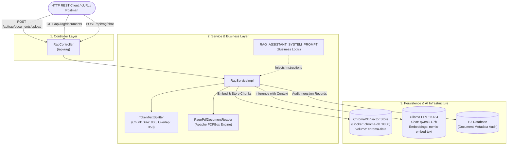

# rag-pdf-chromadb

Spring Boot (version 4.1.1 on Java 25) and Spring AI (version 2.0.1) application implementing an end-to-end **Retrieval-Augmented Generation (RAG)** pipeline for PDF documents, powered by:
- **Ollama**:
  - Chat Model: `qwen3:1.7b`
  - Embedding Model: `nomic-embed-text`
- **Chroma Vector Store**: Vector database for document chunk indexing and semantic similarity search.
- **Spring AI PDF Document Reader**: Document extraction from PDF files via `PagePdfDocumentReader` and chunking with `TokenTextSplitter`.
- **Layered Architecture**: Controllers, Services, Repositories (`JpaRepository`), Entities (`DocumentRecord`), DTOs (`record`), and Mappers (`@Component`).

---

## 1. High-Level Architecture



---

## 2. Prerequisites

### Ollama Models
Ensure Ollama is running locally at `http://localhost:11434` and pull the configured models:

```bash
ollama pull qwen3:1.7b
ollama pull nomic-embed-text
```

### Chroma Vector Store
Start the Chroma DB service using Docker Compose from the project root:

```bash
docker compose up -d
```

Verify that the vector store is healthy and responding at `http://localhost:8000/api/v2/heartbeat`.

---

## 3. Running the Application

Use the included Maven Wrapper:

### Windows:
```powershell
.\mvnw.cmd spring-boot:run
```

### Linux / macOS:
```bash
./mvnw spring-boot:run
```

The application will start on port `8085` (`http://localhost:8085`).

---

## 4. REST API Endpoints (`/api/rag`)

### A. Upload and Index a PDF Document
- **Endpoint:** `POST /api/rag/documents/upload`
- **Content-Type:** `multipart/form-data`

```bash
curl -X POST http://localhost:8085/api/rag/documents/upload \
  -F "file=@/path/to/your/document.pdf"
```

**Response (201 Created):**
```json
{
  "id": 1,
  "fileName": "document.pdf",
  "contentType": "application/pdf",
  "fileSize": 1048576,
  "totalChunks": 18,
  "status": "INDEXED"
}
```

---

### B. List Ingested Documents History
- **Endpoint:** `GET /api/rag/documents`

```bash
curl http://localhost:8085/api/rag/documents
```

**Response (200 OK):**
```json
[
  {
    "id": 1,
    "fileName": "document.pdf",
    "contentType": "application/pdf",
    "fileSize": 1048576,
    "totalChunks": 18,
    "status": "INDEXED"
  }
]
```

---

### C. Ask Questions with RAG Context (Chat)
- **Endpoint:** `POST /api/rag/chat`
- **Content-Type:** `application/json`

```bash
curl -X POST http://localhost:8085/api/rag/chat \
  -H "Content-Type: application/json" \
  -d '{
    "question": "What are the primary findings in this document?",
    "topK": 4
  }'
```

**Response (200 OK):**
```json
{
  "question": "What are the primary findings in this document?",
  "answer": "According to the provided document, the primary findings are...",
  "sourceFiles": [
    "document.pdf"
  ]
}
```

---

## 5. Project Structure

```
rag-pdf-chromadb/
├── docker-compose.yml                                  # Chroma DB container definition
├── pom.xml                                             # Maven build file (Boot 4.1.1, Spring AI 2.0.1)
├── AGENTS.md                                           # Agent governance & architecture specification
├── README.md                                           # English project setup & usage documentation
├── mvnw.cmd / mvnw.ps1 / mvnw                          # Maven wrappers
└── src/
    ├── main/
    │   ├── java/com/venefast/springboot/springiarag/app/
    │   │   ├── SpringiaRagApplication.java             # Main application entry point
    │   │   ├── config/
    │   │   │   └── RagConfig.java                      # ChatClient & TokenTextSplitter bean configuration
    │   │   ├── controllers/
    │   │   │   └── RagController.java                  # REST endpoints for upload and chat
    │   │   ├── services/
    │   │   │   ├── RagService.java                     # Service contract
    │   │   │   └── impl/RagServiceImpl.java            # PDF reading, chunking, Chroma indexing, RAG queries
    │   │   ├── repositories/
    │   │   │   └── DocumentRecordRepository.java       # Spring Data JPA repository for document metadata
    │   │   ├── models/
    │   │   │   ├── entities/
    │   │   │   │   └── DocumentRecord.java             # JPA entity for document persistence
    │   │   │   └── dtos/
    │   │   │       ├── ChatRequestDto.java             # Question input record
    │   │   │       ├── ChatResponseDto.java            # Answer and source files record
    │   │   │       └── DocumentRecordDto.java          # Ingested file metadata record
    │   │   └── mappers/
    │   │       └── DocumentRecordMapper.java           # Bidirectional entity <-> DTO converter
    │   └── resources/
    │       └── application.properties                  # Ollama, Chroma, H2, and Actuator properties
    └── test/
        └── java/com/venefast/springboot/springiarag/app/
            └── SpringiaRagApplicationTests.java        # Context test with mocked AI infrastructure
```

---

## 6. Configuration Reference (`application.properties`)

```properties
spring.application.name=springia-rag
server.port=8085

# Ollama LLM & Embeddings
spring.ai.ollama.base-url=http://localhost:11434
spring.ai.ollama.chat.options.model=qwen3:1.7b
spring.ai.ollama.chat.options.temperature=0.7
spring.ai.ollama.embedding.options.model=nomic-embed-text

# Chroma Vector Store
spring.ai.vectorstore.chroma.client.host=http://localhost
spring.ai.vectorstore.chroma.client.port=8000
spring.ai.vectorstore.chroma.collection-name=springia_rag_collection
spring.ai.vectorstore.chroma.initialize-schema=true

# Database & Actuator
spring.datasource.url=jdbc:h2:mem:ragdb;DB_CLOSE_DELAY=-1;DB_CLOSE_ON_EXIT=FALSE
spring.datasource.driverClassName=org.h2.Driver
spring.datasource.username=sa
spring.datasource.password=
spring.jpa.hibernate.ddl-auto=update
spring.h2.console.enabled=true
management.endpoints.web.exposure.include=health,info,metrics
```
