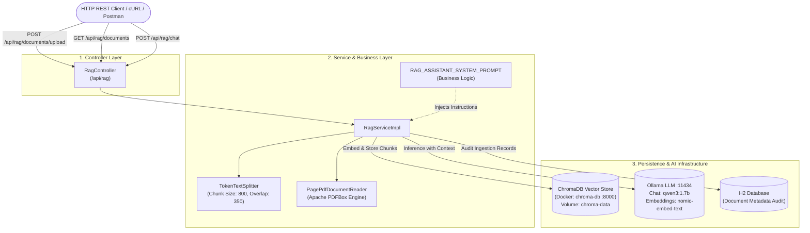

# Executive Project Resume: `springia-rag`

An enterprise-ready **Retrieval-Augmented Generation (RAG)** application built with **Spring Boot 4.1.1**, **Spring AI 2.0.1**, and **Java 25 (LTS)**, designed to ingest PDF documents, index vector embeddings in **ChromaDB**, and answer contextual questions via **Ollama**.

---

## 1. High-Level Architecture Blueprint

---

## 2. Core Capabilities

1. **PDF Ingestion & Token Chunking**:
   - Accepts binary PDF uploads through `POST /api/rag/documents/upload`.
   - Extracts page-by-page text using `PagePdfDocumentReader`.
   - Splits document contents into semantic chunks using `TokenTextSplitter`.
   - Automatically enriches chunks with source metadata (`file_name`, `file_size`).
2. **Vector Indexing (ChromaDB)**:
   - Converts token chunks into high-dimensional numerical embeddings using Ollama's `nomic-embed-text`.
   - Stores embeddings into ChromaDB collection `springia_rag_collection`.
   - Runs in a detached Docker container named `chroma-db` with persistent named volume `chroma-data` mapped to `/data`.
3. **Contextual Question Answering (RAG Chat)**:
   - Accepts queries via `POST /api/rag/chat`.
   - Retrieves top matching semantic chunks from ChromaDB.
   - Leverages `QuestionAnswerAdvisor` on `ChatClient` to supply retrieved context to `qwen3:1.7b`.
   - Returns a structured `ChatResponseDto` containing the answer and the exact `sourceFiles` used.
4. **Relational Audit Trail**:
   - Saves document metadata (`fileName`, `fileSize`, `totalChunks`, `status`) in an in-memory H2 database via Spring Data JPA.

---

## 3. Technology Stack

- **Framework**: Spring Boot 4.1.1
- **AI Integration**: Spring AI 2.0.1
- **Language**: Java 25 (LTS)
- **Vector Database**: ChromaDB (`chromadb/chroma:latest` on Docker)
- **Local AI Provider**: Ollama (Chat: `qwen3:1.7b`, Embedding: `nomic-embed-text`)
- **Persistence**: Spring Data JPA & In-Memory H2 Database
- **Build Tool**: Maven Wrapper (`mvnw.cmd` / `mvnw.ps1` / `./mvnw`)
- **Server Port**: `8085` (`server.port=8085`)

---

## 4. Key Endpoints

| Method | Endpoint | Description |
| :--- | :--- | :--- |
| `POST` | `/api/rag/documents/upload` | Uploads and indexes a PDF document into ChromaDB |
| `GET` | `/api/rag/documents` | Lists all previously ingested document audit records |
| `POST` | `/api/rag/chat` | Asks semantic questions against indexed documents |
| `GET` | `/actuator/health` | Application healthcheck and readiness status |
